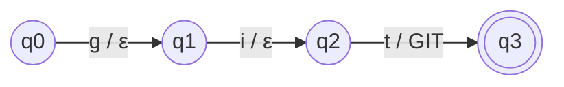
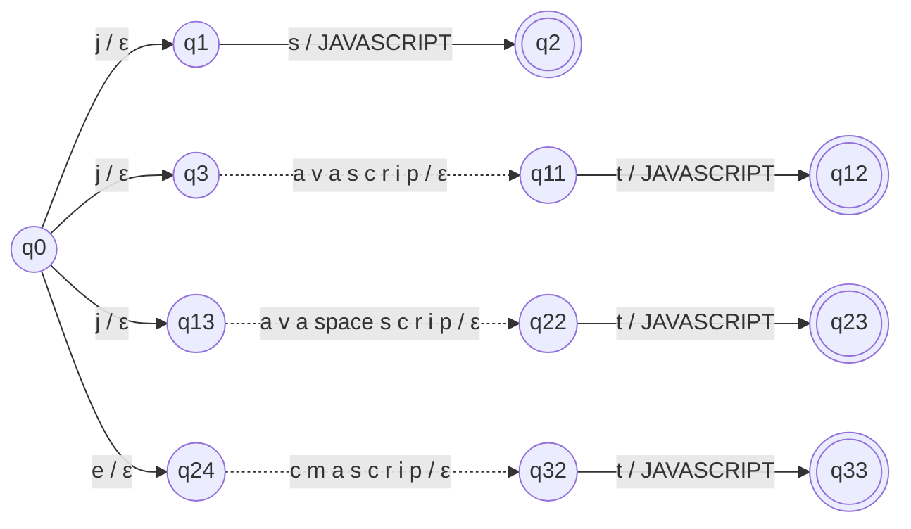
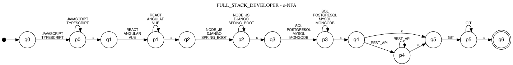
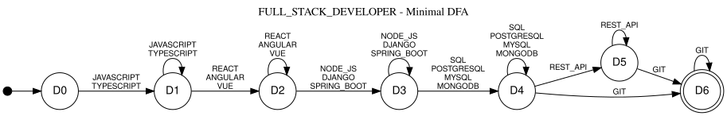
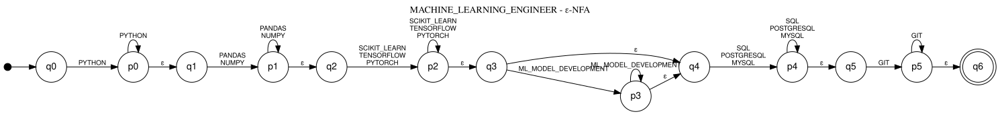
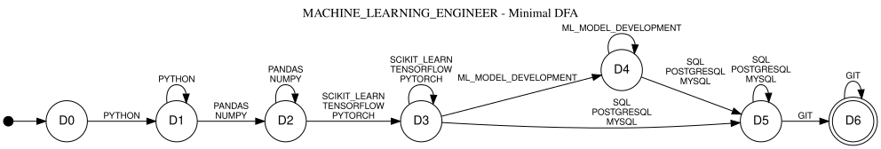
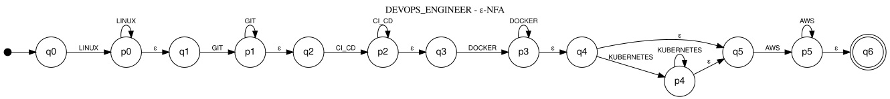
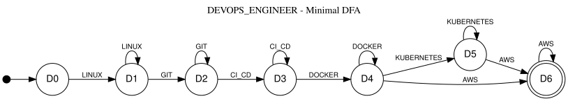
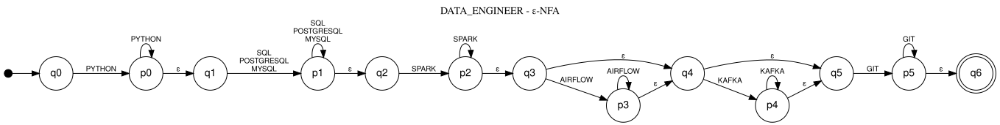
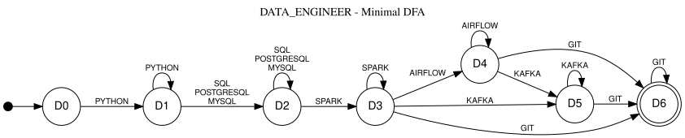

# Formalization of Computational Models

This document presents the formal definitions and theoretical models used across the ResumeLens pipeline. Each section is written by the owner of the stage (see `docs/contracts.md`, Section 1).

---

## 1. Regular Expressions — Stage 1 (Alejo)

### 1.1 Role of Stage 1 in the pipeline

Stage 1 receives the raw text of a résumé and returns an `ExtractionResult`: the candidate data (name, emails, phones, links, education, experience) and `raw_skills`, the list of skill strings found in the text.

Stage 1 only **detects** candidate strings. It does not decide that `JS` and `JavaScript` are the same technology (that is the job of the transducers in Stage 2), and it does not decide whether the candidate satisfies a professional profile (that is Stage 3). For that reason:

* Skills keep their **original spelling and case**, their **order of appearance**, and their **duplicates**.
* `extract()` is **deterministic** and pure: the same text always produces the same result, and the input is never modified.
* The vocabulary (`vocabulary.json`) is read at runtime only by the fallback scan (section 1.4.9), to find known skill spellings when a résumé has no skills section.
* Empty or unparsable text returns an `ExtractionResult` with empty fields, never `None`. A non-`str` input raises `ExtractionError`.

### 1.2 Why regular expressions fit this stage

The information extracted in Stage 1 follows **local surface patterns**: an `@` between two names, groups of digits, a degree keyword, a heading followed by a list, a separator between items. Recognizing each of them does not require remembering an unbounded amount of context or matching nested structures, so each one is describable by a regular language. A finite automaton, which is what the `re` engine compiles a pattern into for this kind of expression, is enough. More structured information (the candidate profile as a whole, with repeated and nested elements) is left to the context-free grammar of Stage 4.

### 1.3 Notation

To describe the languages formally, the following notation is used:

* `a | b` union, `ab` concatenation, `a*` zero or more, `a+` one or more, `a?` optional, `a{m,n}` between `m` and `n` repetitions.
* `[...]` a set of characters (a finite union of symbols).
* `WS` any whitespace character, `D` a decimal digit.
* `L` a Unicode letter. In the code it is written `[^\W\d_]`: "word character that is neither a digit nor an underscore".
* `¬W` means that the neighbouring character must **not** be a word character. It is checked with a lookaround, which does not consume characters.

Python's `re` module offers features beyond textbook regular expressions: flags (`(?i)`, `(?m)`, `(?s)`), lookahead and lookbehind assertions, and named groups. In this stage:

* **Flags** only change which symbols are considered equal (case) or what `^`, `$` and `.` match. They do not add recognition power.
* **Named groups** only label a part of the match for extraction. They do not change the language.
* **Lookarounds** used here have **fixed, bounded width** and check a neighbouring character or a bounded pattern. They can be expressed as an intersection or complement with a regular language, so the language remains regular in practice. No backreferences are used.

### 1.4 The patterns

Each regular expression is defined as a compiled module-level constant in `src/resumelens/extraction.py`. The patterns below are shown as written in the code.

#### Summary

| Constant | Information | Recognizes |
|---|---|---|
| `EMAIL_RE` | Email addresses | Local part, `@`, and a domain with at least one dot |
| `PHONE_RE` | Phone numbers | Optional country code, 3-digit or parenthesized area code, then 3 and 4 digits |
| `LINK_RE` | Links | `http(s)` URLs, GitHub paths and LinkedIn profile paths |
| `NAME_RE` | Candidate name | 2 to 4 words made of letters |
| `EXPERIENCE_RE` | Professional experience | A number of years, an experience phrase and a description (English or Spanish) |
| `EDUCATION_RE` | Academic qualifications | A line with a degree keyword, optional institution and optional year |
| `SKILLS_SECTION_RE` | Skills section | A skills heading and its body |
| `_SKILL_SPLIT_RE` | Skill separators | Commas, semicolons, vertical bars, bullets and line breaks |
| Alias fallback | Skills in free text | Known vocabulary aliases as whole words |

#### 1.4.1 `EMAIL_RE`

```python
EMAIL_RE = re.compile(r"(?i)\b[a-z0-9.!#$%&'*+/=?^_`{|}~-]+@[a-z0-9-]+(?:\.[a-z0-9-]+)+\b")
```

**Pieces.**

* `(?i)`: case-insensitive.
* `\b`: word boundary at both ends of the address.
* `[a-z0-9.!#$%&'*+/=?^_`{|}~-]+`: one or more characters allowed in the local part.
* `@`: the literal at-sign.
* `[a-z0-9-]+`: the first domain label.
* `(?:\.[a-z0-9-]+)+`: one or more further labels, each preceded by a dot.

**Language.** An email-like string with a non-empty local part and a domain with at least one dot. Formally:

```
L+ "@" D+ ("." D+)+      with L = [a-z0-9.!#$%&'*+/=?^_`{|}~-] and D = [a-z0-9-]
```

The boundary `\b` and the case flag do not extend the language beyond a regular one.

**Accepted:** `jose@example.com`, `a+b@x.co` (a `+` is allowed in the local part), `second@example.org`.

**Rejected:** `jose@example` (the domain has no dot), `x@y` (same reason), `@example.com` (empty local part).

**Limitations.** It is meant for extraction, not validation: it accepts some invalid addresses (consecutive dots in the local part, labels starting or ending with `-`), it does not support quoted local parts, and it does not check that the domain exists.

#### 1.4.2 `PHONE_RE`

```python
PHONE_RE = re.compile(r"(?<!\w)(?:\+\d{1,3}[\s-]?)?(?:\(\d{2,4}\)|\d{3})[\s-]?\d{3}[\s-]?\d{4}(?!\w)")
```

**Pieces.**

* `(?<!\w)` and `(?!\w)`: the match must not touch a word character on either side.
* `(?:\+\d{1,3}[\s-]?)?`: an optional country code such as `+57`, with an optional space or hyphen.
* `(?:\(\d{2,4}\)|\d{3})`: either a parenthesized area code of 2 to 4 digits, or 3 digits.
* `[\s-]?\d{3}[\s-]?\d{4}`: 3 digits, an optional separator, and 4 digits.

**Language.**

```
¬W ("+" D{1,3} S?)? ("(" D{2,4} ")" | D{3}) S? D{3} S? D{4} ¬W      with S = [\s-]
```

**Accepted:** `+57 300 123 4567`, `(300) 123-4567`, `300-123-4567`.

**Rejected:** `123` (too short), `300123456` (only nine digits), `abc300-123-4567x` (the digits touch word characters).

**Limitations.** It accepts any digit string with this shape, for instance a long numeric identifier, and it does not check real numbering plans. Extensions (`ext. 12`) and other national layouts are not supported.

#### 1.4.3 `LINK_RE`

```python
LINK_RE = re.compile(
    r"(?i)(?<![\w@])(?:https?://)?(?:www\.)?"
    r"(?:github\.com/[^\s,;|]+|linkedin\.com/in/[^\s,;|]+|https?://[^\s,;|]+)"
)
```

**Pieces.**

* `(?<![\w@])`: the link cannot start right after a word character or an `@` (this avoids matching inside an email address).
* `(?:https?://)?(?:www\.)?`: an optional protocol and an optional `www.`.
* Three alternatives: a GitHub path, a LinkedIn profile path, or any `http(s)` URL.
* `[^\s,;|]+`: the body continues until whitespace, a comma, a semicolon or a vertical bar.

**Language.**

```
¬[\w@] ("http" "s"? "://")? ("www.")?
( "github.com/" X+ | "linkedin.com/in/" X+ | "http" "s"? "://" X+ )
with X = any character except whitespace, ",", ";" and "|"
```

After matching, the extractor removes trailing sentence punctuation (`.,;:!?)]}`) from each link.

**Accepted:** `https://example.com`, `github.com/jose`, `linkedin.com/in/jose`.

**Rejected:** `ftp://example.com` (only `http` and `https` are supported), `github.com` (no path), `text@github.com/user` (preceded by `@`).

**Limitations.** Arbitrary domains without a protocol (`example.com`) are not captured, and the URL is not validated beyond its shape.

#### 1.4.4 `NAME_RE`

```python
NAME_RE = re.compile(
    r"^[^\W\d_]+(?:[-'][^\W\d_]+)?"
    r"(?:\s+[^\W\d_]+(?:[-'][^\W\d_]+)?){1,3}$",
    re.UNICODE,
)
```

**Pieces.**

* `^` and `$`: the whole line must match.
* `[^\W\d_]+`: one or more Unicode letters.
* `(?:[-'][^\W\d_]+)?`: an optional hyphenated or apostrophe part (`O'Connor`).
* `(?:\s+ ... ){1,3}`: between one and three more words, so the name has 2 to 4 words.

**Language.**

```
W ([-'] W)? ( WS+ W ([-'] W)? ){1,3}      with W = L+
```

**Accepted:** `José Peña`, `Ada Lovelace`, `John O'Connor`.

**Rejected:** `Ada` (only one word), `John 123` (digits), `John_Smith` (underscore, and a single word).

**How it is used.** The extractor applies `NAME_RE` only to the **first non-empty line** of the résumé; if that line is not a name, the name stays `""`.

**Limitations.** One-word names, names with more than four words and names with titles or periods (`Dr. Ada Lovelace`) are not recognized. Any first line made of 2 to 4 letter-only words (for example a job title) is a false positive.

#### 1.4.5 `EXPERIENCE_RE`

```python
EXPERIENCE_RE = re.compile(
    r"(?im)^\s*(?P<years>\d+(?:\.\d+)?)\s*\+?\s*(?:years?|años?)"
    r"\s+(?:of\s+|de\s+)?(?:experience|experiencia)\s*(?:en\s+)?"
    r"(?P<description>[^.\r\n]+)\.?\s*$"
)
```

**Pieces.**

* `(?im)`: case-insensitive and multiline (so `^` and `$` delimit a line).
* `(?P<years>\d+(?:\.\d+)?)`: an integer or decimal number, captured as `years`.
* `\s*\+?\s*`: an optional plus sign (`5+ years`).
* `(?:years?|años?)`: the unit word in English or Spanish.
* `(?:of\s+|de\s+)?(?:experience|experiencia)`: an optional connector and the word for experience.
* `(?:en\s+)?`: an optional Spanish connector.
* `(?P<description>[^.\r\n]+)`: the description, captured until a period or the end of the line.

**Language.**

```
WS* N WS* "+"? ("year"|"years"|"año"|"años") WS+ (("of"|"de") WS+)?
("experience"|"experiencia") WS* ("en" WS+)? T+ "."? WS*
with N = D+ ("." D+)? and T = any character except ".", CR and LF
```

The extractor converts `years` to a `float` and strips the `description`.

**Accepted:** `3 years of experience developing web applications.`, `5+ years of experience leading teams.`, `3 años de experiencia en análisis de datos.`

**Rejected:** `years of experience` (no number), `3 years of experience.` (no description), `3 months of experience coding.` (only years are supported).

**Limitations.** The statement must start its line. Descriptions cannot contain an inner period. Written numbers (`three years`), months and phrasings such as "over 3 years" are not supported.

#### 1.4.6 `EDUCATION_RE`

```python
EDUCATION_RE = re.compile(
    r"(?im)^\s*(?P<degree>.*?\b(?:B\.?\s*Sc\.?|M\.?\s*Sc\.?|Ph\.?D\.?|"
    r"bachelor(?:'s)?|master(?:'s)?|engineer(?:ing)?|ingenier[ií]a|"
    r"licenciatura|doctorate|degree)\b.*?)"
    r"(?:\s*[-,|]\s*|\s+)(?P<institution>(?:Universidad|University(?:\s+of)?)[^,|;\r\n]*?)?"
    r"(?:\s*[-,|]?\s*(?P<year>\d{4}(?:\s*-\s*\d{4})?))?\s*$"
)
```

**Pieces.**

* `(?P<degree>.*?\b(?:...)\b.*?)`: a line fragment that contains one degree keyword (BSc, MSc, PhD, bachelor, master, engineer, engineering, ingeniería, licenciatura, doctorate, degree).
* `(?:\s*[-,|]\s*|\s+)`: a **mandatory separator** (a hyphen, comma or bar, or whitespace) after the degree.
* `(?P<institution>...)?`: an optional institution that starts with `Universidad` or `University` (`University of`).
* `(?P<year>\d{4}(?:\s*-\s*\d{4})?)`: an optional year or year range.
* `\s*$`: the end of the line.

**Language.** A line with a degree keyword, followed by a separator, optionally followed by a university-style institution and optionally by a year or range:

```
WS* DEGREE_TEXT SEP (INSTITUTION)? ( WS* [-,|]? WS* YEAR )? WS*
with SEP = (WS* [-,|] WS* | WS+) and YEAR = D{4} (WS* "-" WS* D{4})?
```

**How it is used.** Besides the pattern, `extract()` discards a match whose degree is only `Engineer` or `Engineering` unless the line also has an institution or a year. This avoids reading a job title such as "Software Engineer" as education.

**Accepted:** `B.Sc. Computer Science - Universidad de los Andes - 2020-2024` (degree `B.Sc. Computer Science`, institution `Universidad de los Andes`, year `2020-2024`), `PhD University X`, `Master's Degree - University of Toronto - 2024`.

**Rejected:** `Computer Science - College X` (no degree keyword), `B.Sc. Computer Science - 20` (the year needs four digits), `B.Sc. Computer Science` (a degree line with **no separator, institution or year** after it; see the limitations).

**Limitations.** Only institutions that begin with `Universidad` or `University` are recognized. Because the pattern requires a separator after the degree, a line that contains **only** the degree (`B.Sc. Computer Science`, `Bachelor in Computer Science`) is not captured, unless it has trailing whitespace. Institution extraction is a best effort.

#### 1.4.7 `SKILLS_SECTION_RE`

```python
SKILLS_SECTION_RE = re.compile(
    r"(?ims)^[ \t]*(?:technical skills|skills|tech stack)[ \t]*:?[ \t]*(?:\r?\n)?"
    r"(?P<body>.*?)(?=\r?\n[ \t]*\r?\n"
    r"|\r?\n[ \t]*[^:\r\n]{1,60}[ \t]*:[ \t]*(?:\r?\n|$)"
    r"|\r?\n[ \t]*(?:education|experience|projects|languages|certifications|contact|summary)"
    r"[ \t]*(?:\r?$)|\Z)"
)
```

**Pieces.**

* `(?ims)`: case-insensitive, multiline, and `.` also matches line breaks.
* `^[ \t]*(?:technical skills|skills|tech stack)[ \t]*:?`: a heading, with an optional colon.
* `(?P<body>.*?)`: the body, taken lazily (the shortest text up to a terminator).
* The lookahead `(?= ... )` ends the body at the first of: a blank line, a new heading that ends with a colon, a known heading without colon (`education`, `experience`, `projects`, `languages`, `certifications`, `contact`, `summary`), or the end of the text.

**Language.** A skills heading followed by the shortest body that precedes one of the terminators above.

**Accepted:** `Technical Skills:\nJS, React.js` (body `JS, React.js`), `Skills: Python\n\nEducation` (body `Python`, stopped by the blank line), `Technical Skills:\nPython, Git\nEducation\nB.Sc. X` (body `Python, Git`, stopped by the heading `Education` without colon).

**Rejected as a heading:** `Technical Skill` (singular), `Abilities:` (not one of the three accepted headings).

**Limitations.** Only three heading names are recognized. The body stops at any short line that ends with a colon, even if it is not a heading. If no terminator appears, the body extends to the end of the text. The pattern does not check that each item is a known skill.

#### 1.4.8 `_SKILL_SPLIT_RE`

```python
_SKILL_SPLIT_RE = re.compile(r"[,;|\u2022\r\n]+")
```

**Pieces.** A character class with the separators comma, semicolon, vertical bar, bullet (`•`), carriage return and line feed, repeated one or more times.

**Language.** `(","|";"|"|"|"•"|CR|LF)+`

**Accepted as a separator:** `,`, `;|`, `•`, a line break.

**Rejected:** a single space (`JS React` is **one** item), `/` (so `CI/CD` is not split), `:`.

**How it is used.** The skills body is split with this expression; each piece is then stripped of surrounding whitespace and of **one** trailing period, and empty pieces are discarded. The order, the case and the duplicates are preserved.

**Limitations.** Skills separated only by spaces are not split, and a skill name that contains one of the separators cannot be represented.

#### 1.4.9 Alias fallback (free-text scan)

When the résumé has **no** skills section, `extract()` looks for known skill spellings in the whole text. The pattern is built at runtime from the aliases in `vocabulary.json` (via `alias_index()`):

```python
aliases = sorted(
    (alias for alias in alias_index()
     if len(alias) >= 3 and alias.casefold() not in _FALLBACK_STOPWORDS),
    key=len, reverse=True,
)
alias_pattern = re.compile(
    r"(?i)(?<![\w])(?:" + "|".join(re.escape(a) for a in aliases) + r")(?![\w])"
)
```

with `_FALLBACK_STOPWORDS = {"rest", "node", "torch"}`.

**Design decisions.**

* The alternation is built from the vocabulary, not from a copy, so the extractor and the transducers always share one source of truth (contract section 3.2, rule 4).
* Aliases are sorted by **decreasing length**, so a longer alias (`javascript`) is tried before a shorter one that is its prefix (`java`).
* `¬W` on both sides forces **whole-word** matches.
* Aliases shorter than three characters (`js`, `ts`, `ml`, `tf`, `py`) and the ambiguous words `rest`, `node` and `torch` are ignored: in free text they produce too many false positives.
* The surface text is returned **exactly as it appears** in the résumé.

**Language.** `¬W (A1 | A2 | ... | An) ¬W`, where each `Ai` is one literal alias.

**Accepted:** `React.js` and `Git` in "I work with React.js and Git." (result `["React.js", "Git"]`).

**Rejected:** `JS`, `ML`, `TF` (too short), `Node`, `Torch`, `REST` (stopwords). For example "I use JS, ML, TF, REST, Node, Torch, Git, and React." produces `["Git", "React"]`.

**Limitations.** It cannot tell a technology from the same word used in ordinary prose, and the stopword list is chosen by hand. The fallback is used only when no skills section is found; a skills section takes precedence.

### 1.5 Implementation and stored output

`extract(text: str) -> ExtractionResult` validates the type of the input and calls one helper per information type: name, emails, phones, links, education, experience and skills. It builds a `Candidate` and an `ExtractionResult` (`src/resumelens/models.py`).

* Matches are returned **in order of appearance**.
* Emails, phones and links are stored as lists of strings; links lose trailing sentence punctuation.
* Experience is stored as `Experience(years: float, description: str)`.
* Education is stored as `Education(degree, institution, year)`, with empty strings for missing fields.
* `raw_skills` is stored as a list of strings, unmodified, which becomes the input of Stage 2.

The behavior is covered by `tests/test_extraction.py` (each pattern, English and Spanish variants, empty input, invalid types, determinism) and, together with Stage 2, by `tests/test_stage1_2.py` (the two résumés of the assignment and every file in `samples/`).

### 1.6 Limitations of Stage 1

* The **name** is read only from the first non-empty line; a résumé that starts with a title (`Resume`, `Curriculum Vitae`) leaves it empty, and a first line made of 2 to 4 letter-only words that is not a name is a false positive.
* **Experience** is detected only when the statement starts its line, and only with a number of years (not months or written numbers).
* **Education** needs a degree keyword followed by a separator; a line with only the degree is not captured, and only institutions that start with `Universidad` or `University` are recognized.
* The **skills section** is recognized under three headings; the body can stop early at a short line that ends with a colon or run on if no terminator exists.
* The **fallback** ignores aliases shorter than three characters and `rest`, `node`, `torch`, so skills such as `JS` or `ML` are only found inside a skills section.
* Emails, phones and links are matched by shape, not validated.

---

## 2. Finite-State Transducers — Stage 2 (Alejo)

### 2.1 Definition used

A **finite-state transducer** (FST) reads an input word symbol by symbol, moves between a finite set of states, and **produces output** symbols while it moves. A finite automaton only accepts or rejects; a transducer also translates.

Each transducer is a 7-tuple `M = (Q, Σ, Γ, δ, ω, q0, F)`:

* `Q`: the finite set of states.
* `Σ`: the input alphabet.
* `Γ`: the output alphabet.
* `δ`: the transition relation, which says to which states the machine can move from a state on an input symbol.
* `ω`: the output relation, which says what is written on each transition.
* `q0 ∈ Q`: the initial state.
* `F ⊆ Q`: the accepting states.

### 2.2 Purpose

The same technology appears with different spellings: `JS`, `Javascript` and `javascript`; `React.js`, `ReactJS` and `react js`; `Postgres` and `PostgreSQL`. Stage 2 transforms every accepted spelling into one **canonical token** (`JAVASCRIPT`, `REACT`, `POSTGRESQL`, ...). The tokens form the alphabet that the automata of Stage 3 consume, so the output set of Stage 2 is the input alphabet of Stage 3.

### 2.3 Design decisions

(From `docs/contracts.md`, section 8.)

| Decision | What it states | Reason |
|---|---|---|
| D1 | Case and whitespace are handled by a plain function `preprocess()` **before** the transducers | The transducers need only lowercase transitions, so the alphabet stays small and can be listed completely in the 7-tuple |
| D2 | Σ = `a-z`, `0-9`, space, `.`, `-`, `/`; Γ = `A-Z`, `_` | A finite, explicit alphabet that covers the whole vocabulary |
| D4 | A string that no transducer accepts goes to `unrecognized` and is not passed on | A transducer without an accepting path produces no output; nothing is guessed, and every rejection stays traceable |
| D6 | Duplicate tokens are removed after normalization, keeping the order of first appearance | `JS` and `Javascript` give a single `JAVASCRIPT` |
| D9 | One transducer per canonical token, all generated by the same function from `vocabulary.json` | Readable machines and a single code path; adding an alias never requires code changes |

### 2.4 Preprocessing (outside the transducers)

`preprocess(raw)` applies, in this order:

1. `strip()`: remove leading and trailing whitespace.
2. `casefold()`: lowercase.
3. Collapse every run of whitespace into one space.
4. Remove trailing `,`, `;` or `:`, and one final `.`.

Example: `"  React.js, "` → `"react.js,"` (strip and casefold) → `"react.js"` (trailing comma removed). The internal dot is kept because it is part of an alias.

A character outside Σ makes the string **unrecognized**.

### 2.5 General construction

For a canonical token `t` with aliases `A_t = {a_1, ..., a_k}`, where `a_i = c_{i,1} c_{i,2} ... c_{i,n_i}`, the transducer `M_t = (Q_t, Σ, Γ_t, δ_t, ω_t, q0, F_t)` is:

* **States.** `Q_t = {0} ∪ { q_{i,j} : 1 ≤ j ≤ n_i }`: the initial state `0` and **one new state per character of each alias**. Aliases do not share states, even when they share a prefix. Therefore `|Q_t| = 1 + Σ n_i`.
* **Input alphabet.** `Σ = {a..z, 0..9, " ", ".", "-", "/"}` (40 symbols), declared once in the code (`INPUT_ALPHABET`). Each concrete `M_t` only uses a subset.
* **Output alphabet.** `Γ_t` is the set of characters of the token `t`, a subset of `Γ = {A..Z, "_"}`.
* **Transition relation.** Writing `q_{i,0} = 0`, for every alias `i` and position `j`:

  ```
  q_{i,j} ∈ δ_t( q_{i,j-1}, c_{i,j} )
  ```

  There are `Σ n_i` transitions in total. Because several aliases can start with the same letter, `δ_t(0, c)` can contain several states: `δ_t` is a **relation**, not a function.
* **Output relation.**

  ```
  ω_t( q_{i,j-1}, c_{i,j}, q_{i,j} ) = ε    if j < n_i
  ω_t( q_{i,n_i-1}, c_{i,n_i}, q_{i,n_i} ) = t    (the characters of the token)
  ```

  Nothing is written along an alias; the whole token is emitted on its **last** transition.
* **Initial state.** `q0 = 0`.
* **Accepting states.** `F_t = { q_{i,n_i} : 1 ≤ i ≤ k }`: the last state of each alias, one per alias.

The relation realized by `M_t` is the finite set `{ (a, t) : a ∈ A_t }`: every alias is translated to `t` and nothing else.

**Whole-string matching.** The machine produces output only when the whole input follows a complete alias path and ends in a state of `F_t`. A prefix such as `java` does not reach a final state of the `JAVASCRIPT` machine, so it is not accepted there.

### 2.6 Implementation with pyformlang

`build_transducer(canonical, aliases)` creates a `pyformlang.fst.FST`, adds state `0` as the start state, and for each alias walks from state `0`, adding a fresh state per character. Intermediate transitions have an empty output list; the last transition has `list(canonical)` as output (pyformlang represents the output word as a list of characters). The last state of the alias is added as a final state.

`_apply_transducer(transducer, text)` first rejects any text with a character outside `INPUT_ALPHABET`, then calls `translate`, and accepts only when it obtains **exactly one** output, which it joins into a string.

`normalize(raw_skills)` uses one transducer per token, built once from the vocabulary (`default_vocabulary()`), and applies them in this way:

1. Validate that the argument is a list or tuple of strings (otherwise `TypeError`).
2. For each raw string: `preprocess` it, then apply **every** per-token transducer. The token is accepted when **exactly one** transducer recognizes the string.
3. If none (or more than one) recognizes it, the raw string is added to `unrecognized` (no repeated entries). No error is raised.
4. Otherwise `mapping[raw] = token`, with the **original** raw string as the key, and the token is appended to `tokens` only if it is not already there.

`normalize()` does **not** sort or filter by profile: that is Stage 2b. The result is a `NormalizationResult(tokens, mapping, unrecognized)`.

Guarantees (contract section 10): `mapping` keys and `unrecognized` are disjoint and together equal the set of raw strings; every token belongs to the vocabulary; tokens have no duplicates; the input is not modified; the result is deterministic.

### 2.7 Fully worked example: `JAVASCRIPT`

Aliases: `js`, `javascript`, `java script`, `ecmascript`.

* `Q = {0, 1, ..., 33}` (34 states)
* `Σ` (declared) as in section 2.5. **Symbols actually used:** space and `a c e i j m p r s t v`.
* `Γ` (actually used) = `{J, A, V, S, C, R, I, P, T}`
* `q0 = 0`
* `F = {2, 12, 23, 33}`

Transitions `δ` and outputs `ω` (`J·A·V·A·S·C·R·I·P·T` is the output `JAVASCRIPT`; `ε` is the empty output):

| Alias | From | Input | To | Output |
|---|---:|---|---:|---|
| `js` | 0 | `j` | 1 | ε |
| | 1 | `s` | 2 | JAVASCRIPT |
| `javascript` | 0 | `j` | 3 | ε |
| | 3 | `a` | 4 | ε |
| | 4 | `v` | 5 | ε |
| | 5 | `a` | 6 | ε |
| | 6 | `s` | 7 | ε |
| | 7 | `c` | 8 | ε |
| | 8 | `r` | 9 | ε |
| | 9 | `i` | 10 | ε |
| | 10 | `p` | 11 | ε |
| | 11 | `t` | 12 | JAVASCRIPT |
| `java script` | 0 | `j` | 13 | ε |
| | 13 | `a` | 14 | ε |
| | 14 | `v` | 15 | ε |
| | 15 | `a` | 16 | ε |
| | 16 | (space) | 17 | ε |
| | 17 | `s` | 18 | ε |
| | 18 | `c` | 19 | ε |
| | 19 | `r` | 20 | ε |
| | 20 | `i` | 21 | ε |
| | 21 | `p` | 22 | ε |
| | 22 | `t` | 23 | JAVASCRIPT |
| `ecmascript` | 0 | `e` | 24 | ε |
| | 24 | `c` | 25 | ε |
| | 25 | `m` | 26 | ε |
| | 26 | `a` | 27 | ε |
| | 27 | `s` | 28 | ε |
| | 28 | `c` | 29 | ε |
| | 29 | `r` | 30 | ε |
| | 30 | `i` | 31 | ε |
| | 31 | `p` | 32 | ε |
| | 32 | `t` | 33 | JAVASCRIPT |

That is 2 + 10 + 11 + 10 = 33 transitions, and 33 + 1 = 34 states. Any other pair (state, symbol) has no transition.

**Non-determinism.** From state `0` on the symbol `j` the machine can go to states `1`, `3` or `13`, one for each alias that starts with `j`. The machine is therefore **non-deterministic** in its transition structure. This does not make the output ambiguous: aliases are unique across the vocabulary, only a **complete** path ending in a final state produces output, and every complete path of `M_JAVASCRIPT` produces the same token.

**Why `java` is not accepted.** After reading `j-a-v-a` the machine can only be in state `6` (path of `javascript`) or state `16` (path of `java script`); neither is in `F`. Without an accepting state there is no output, so `java` is not translated by `M_JAVASCRIPT`. The transducer of the token `JAVA`, whose only alias is `java`, does accept it.

### 2.8 Small example: `GIT`

Alias: `git`.

* `Q = {0, 1, 2, 3}`, `q0 = 0`, `F = {3}`
* `Σ` used: `g`, `i`, `t`. `Γ` used: `G`, `I`, `T`.

| From | Input | To | Output |
|---:|---|---:|---|
| 0 | `g` | 1 | ε |
| 1 | `i` | 2 | ε |
| 2 | `t` | 3 | GIT |

### 2.9 Worked trace

For the raw string `"  React.js, "` (aliases of `REACT`: `react`, `react.js`, `reactjs`, `react js`):

1. `preprocess("  React.js, ")` = `"react.js"`.
2. In `M_REACT`, from state `0` on `r` the machine can go to states `1`, `6`, `14` and `21` (one per alias).
3. Only the branch of the alias `react.js` can continue with `e`, `a`, `c`, `t`, `.`: `6 → 7 → 8 → 9 → 10 → 11`.
4. Then `j` leads to `12` and `s` leads to `13`, which is final, and the last transition emits `REACT`.
5. The other transducers (`JAVASCRIPT`, `NODE_JS`, ...) do not accept `react.js`, so exactly one machine accepts it, and `mapping["  React.js, "] = "REACT"` (the key is the original string).

### 2.10 Data of the 30 transducers

Counted from the real vocabulary (30 canonical tokens, 80 aliases). "States" includes state 0; "Transitions" counts the transitions of the alias paths.

| Token | Aliases | States | Transitions | Final states |
|---|---:|---:|---:|---:|
| JAVASCRIPT | 4 | 34 | 33 | 4 |
| TYPESCRIPT | 3 | 24 | 23 | 3 |
| PYTHON | 3 | 16 | 15 | 3 |
| JAVA | 1 | 5 | 4 | 1 |
| SQL | 1 | 4 | 3 | 1 |
| REACT | 4 | 29 | 28 | 4 |
| ANGULAR | 3 | 27 | 26 | 3 |
| VUE | 4 | 21 | 20 | 4 |
| NODE_JS | 4 | 25 | 24 | 4 |
| DJANGO | 1 | 7 | 6 | 1 |
| SPRING_BOOT | 3 | 33 | 32 | 3 |
| REST_API | 5 | 40 | 39 | 5 |
| POSTGRESQL | 3 | 30 | 29 | 3 |
| MYSQL | 2 | 12 | 11 | 2 |
| MONGODB | 3 | 21 | 20 | 3 |
| GIT | 1 | 4 | 3 | 1 |
| PANDAS | 1 | 7 | 6 | 1 |
| NUMPY | 2 | 12 | 11 | 2 |
| SCIKIT_LEARN | 4 | 43 | 42 | 4 |
| TENSORFLOW | 3 | 24 | 23 | 3 |
| PYTORCH | 3 | 21 | 20 | 3 |
| ML_MODEL_DEVELOPMENT | 4 | 45 | 44 | 4 |
| LINUX | 3 | 21 | 20 | 3 |
| CI_CD | 3 | 15 | 14 | 3 |
| DOCKER | 1 | 7 | 6 | 1 |
| KUBERNETES | 2 | 14 | 13 | 2 |
| AWS | 2 | 23 | 22 | 2 |
| SPARK | 3 | 25 | 24 | 3 |
| AIRFLOW | 2 | 22 | 21 | 2 |
| KAFKA | 2 | 18 | 17 | 2 |
| **Total** | **80** | **629** | **599** | **80** |

For every token, `states = transitions + 1` and `final states = aliases`, as the construction of section 2.5 predicts.

### 2.11 Relation with the rest of the pipeline

* The output of `normalize()` (canonical tokens) is sorted and filtered by profile in Stage 2b, and then read by the finite automata of Stage 3, where **each token is one symbol** of the automaton alphabet (decision D3 of the contract). The characters `A-Z` and `_` of Γ are only the internal representation of that symbol.
* The transducers do not know about profiles; they only know the vocabulary.

At character level, Γ = {A–Z, _}; each transducer writes the characters of one token, and that whole word is a single symbol of the alphabet of Stage 3.

### 2.12 Limitations of Stage 2

* The transducers recognize only the **aliases listed** in the vocabulary. A misspelling (`javscript`) or a technology that is not in the vocabulary is `unrecognized`. Adding a spelling means adding an alias to `vocabulary.json`.
* Characters outside Σ (for example `#` or `+` in `c#` or `c++`) make a string unrecognized.
* The construction does **not share prefixes**: it is simple and correct, but it uses more states than a minimal deterministic machine (629 states for 80 aliases). Merging common prefixes, or determinizing and minimizing each machine, would reduce the size without changing the translation.
* Case, spacing and trailing punctuation are normalized by `preprocess()` and not by the transducers, so the formal machines describe only the lowercase alias vocabulary.
* If two different transducers recognized the same string, the string would be treated as unrecognized. The vocabulary loader rejects repeated aliases, so this cannot happen with the current vocabulary.


### 2.13 Transition diagrams

Diagram conventions: a circle is a state, a double circle is an accepting state, and a label `x / y` on an arrow means "read the input symbol `x` and write the output `y`" (`ε` is the empty output).

#### 2.13.1 `GIT`



#### 2.13.2 `JAVASCRIPT` (fragment showing the non-determinism)

State `q0` has three outgoing arrows labelled `j`, one for each alias that starts with that letter (`js`, `javascript`, `java script`). The dotted arrows stand for the omitted intermediate states of each alias path (the full table is in section 2.7).



#### 2.13.3 How to reproduce the diagrams

The diagrams are generated from the same information as the machines: each canonical token and its aliases in `vocabulary.json`, through `build_transducer`. To list the transitions of any token:

```python
from resumelens.normalization import build_transducer
from resumelens.vocabulary import default_vocabulary

entry = default_vocabulary()["JAVASCRIPT"]
transducer = build_transducer("JAVASCRIPT", list(entry.aliases))
for (state, symbol), paths in sorted(transducer.__dict__["_delta"].items()):
    print(state, symbol, "->", paths)
```

(`_delta` is pyformlang's internal transition map. The synthetic edge `starting_0` that pyformlang adds when it draws the graph is not a transition of the machine and is not counted in the tables.)

### 2.14 Verification

* Run the tests: `python -m pytest -q`.
* The invariants of the contract (section 10) are checked for every case of `tests/test_stage1_2.py`: every raw string is either mapped or unrecognized, never both; every token belongs to the vocabulary; tokens have no duplicates; repeated runs give equal results; the input text is not modified.
* The totals of section 2.10 can be recomputed with the code of section 2.13.3 and the vocabulary loader.

---

## 3. Finite Automata — 5-Tuple (Stage 3 — Diego)

*Stage 3: qualification pattern recognition. Owner: Diego (Juan Diego Balanta Molina). Code: `src/resumelens/recognition.py`, `src/resumelens/sorting.py`, `profiles/*.json`.*

### 3.1 What the automata decide

Each of the four professional profiles has its own automaton. The automaton reads the canonical tokens of a résumé (output of Stage 2, already filtered and sorted for that profile by Stage 2b) and answers ACCEPTED or REJECTED. A résumé is evaluated against the four profiles independently, so it can be accepted by several of them or by none. The result is binary per profile; it is not a ranking of candidates.

### 3.2 Alphabet

The input alphabet of every automaton is a subset of the canonical vocabulary (`src/resumelens/vocabulary.json`), which is exactly the output alphabet Γ of the Stage 2 transducers. Each canonical token is **one symbol**: `NODE_JS` is a single letter of Σ, not a sequence of characters. For a profile with slots S1, …, Sn,

Σ = S1 ∪ S2 ∪ … ∪ Sn

where Si is the set of tokens of slot i (`any_of`). The sets Si are pairwise disjoint (rule 4 of the profile format), so every symbol belongs to exactly one slot.

Tokens of the résumé that belong to no slot of the profile are removed by Stage 2b before the automaton runs (design decision D5). Without that filter, a Full Stack candidate who also lists Docker would be rejected for knowing *more*, and the alphabet would have to include the whole vocabulary.

### 3.3 Construction and type of the automata

All four automata are produced by the same function, `build_enfa(profile)`, from the ordered list of slots. This keeps the four profiles in one general solution (assignment requirement) and makes the diagrams and tables in this document reproducible: they are generated from the same objects that classify résumés (`scripts/export_diagrams.py`).

**Pattern.** A profile pattern is satisfied when the slots appear in order and every mandatory slot contributes at least one of its tokens; an optional slot may be absent; a slot may contribute several tokens (Mary Jane Watson lists both Pandas and NumPy). Over Σ this is the regular language

L = S1^k1 · S2^k2 · … · Sn^kn,  with ki = `+` if slot i is mandatory and ki = `*` if it is optional.

**States.** For n slots, Q = {q0, …, qn} ∪ {p0, …, p(n-1)}, so |Q| = 2n + 1:

* qi means "the automaton is about to read slot i" (qn means "all slots are done");
* pi means "at least one token of slot i has been read".

**Transitions.** For every slot i and every token t ∈ Si:

* δ(qi, t) ∋ pi: the first token of the slot;
* δ(pi, t) ∋ pi: more tokens of the same slot (loop);
* δ(pi, ε) ∋ q(i+1): the slot is satisfied, move to the next one;
* δ(qi, ε) ∋ q(i+1): only when slot i is optional, skip it.

**Initial and accepting states.** q0 is the initial state and F = {qn}.

**Type: ε-NFA.** The transition relation is δ : Q × (Σ ∪ {ε}) → P(Q) and it contains ε-moves (pi →ε q(i+1) for every slot, and qi →ε q(i+1) for optional slots). A DFA requires δ : Q × Σ → Q, with no ε and exactly one next state, and a plain NFA allows several next states but no ε. Because ε appears in the domain of δ, these automata are ε-NFAs. `automaton_kind()` in the code checks exactly this property on the transition relation.

We use the ε-NFA as the model because it is a direct, slot-by-slot translation of the profile: each slot is a small "one-or-more" gadget joined to the next by ε, and an optional slot is just one extra ε-edge. Adding or editing a profile does not require redrawing anything by hand.

**Equivalent DFA.** By subset construction with ε-closures (`build_dfa`) and minimization (`build_minimal_dfa`) every ε-NFA becomes a minimal DFA; for the four profiles of this project it has n + 1 = 7 states, D0, …, D6 (one state per slot already satisfied). The tests (`tests/test_automata.py`) check with pyformlang that the three automata (ε-NFA, DFA, minimal DFA) accept the same language for the four profiles, and compare them on random and exhaustively enumerated words. Both versions are shown for each profile below.

**Order inside a slot.** The slot loop accepts the tokens of a slot in any order. Stage 2b always delivers them in the order of `any_of`, so the language is slightly larger than the set of sequences that can actually reach the automaton; this keeps the automaton small and does not change any result.

### 3.4 Full Stack Developer (`FULL_STACK_DEVELOPER`)

**Profile pattern.** A Full Stack Developer must show a client-side language, a frontend framework, a backend technology, a database and version control. REST APIs are listed in the assignment as a possible qualification, but the reference résumé (Wednesday Addams) does not mention them and is expected to be accepted, so the API slot is optional.

| Slot | Category | Tokens (`any_of`) | Repetition |
|---|---|---|---|
| 1 | LANGUAGE | `JAVASCRIPT`, `TYPESCRIPT` | mandatory (`+`) |
| 2 | FRONTEND | `REACT`, `ANGULAR`, `VUE` | mandatory (`+`) |
| 3 | BACKEND | `NODE_JS`, `DJANGO`, `SPRING_BOOT` | mandatory (`+`) |
| 4 | DATABASE | `SQL`, `POSTGRESQL`, `MYSQL`, `MONGODB` | mandatory (`+`) |
| 5 | API | `REST_API` | optional (`*`) |
| 6 | VERSION_CONTROL | `GIT` | mandatory (`+`) |

**Language recognized** (regular expression over Σ, `|` = union, `+` = one or more, `*` = zero or more):

```
(JAVASCRIPT | TYPESCRIPT)+ (REACT | ANGULAR | VUE)+ (NODE_JS | DJANGO | SPRING_BOOT)+
(SQL | POSTGRESQL | MYSQL | MONGODB)+ (REST_API)* (GIT)+
```

**Formal definition (ε-NFA).** M = (Q, Σ, δ, q0, F) where

* Q = {q0, q1, q2, q3, q4, q5, q6, p0, p1, p2, p3, p4, p5} (13 states)
* Σ = {JAVASCRIPT, TYPESCRIPT, REACT, ANGULAR, VUE, NODE_JS, DJANGO, SPRING_BOOT, SQL, POSTGRESQL, MYSQL, MONGODB, REST_API, GIT}
* Initial state: q0
* F = {q6}
* δ : Q × (Σ ∪ {ε}) → P(Q) is given by the table below (every pair not listed maps to ∅):

| From | Reads | To |
|---|---|---|
| q0 | `JAVASCRIPT`, `TYPESCRIPT` | p0 |
| p0 | `JAVASCRIPT`, `TYPESCRIPT` | p0 |
| p0 | `ε` | q1 |
| q1 | `REACT`, `ANGULAR`, `VUE` | p1 |
| p1 | `REACT`, `ANGULAR`, `VUE` | p1 |
| p1 | `ε` | q2 |
| q2 | `NODE_JS`, `DJANGO`, `SPRING_BOOT` | p2 |
| p2 | `NODE_JS`, `DJANGO`, `SPRING_BOOT` | p2 |
| p2 | `ε` | q3 |
| q3 | `SQL`, `POSTGRESQL`, `MYSQL`, `MONGODB` | p3 |
| p3 | `SQL`, `POSTGRESQL`, `MYSQL`, `MONGODB` | p3 |
| p3 | `ε` | q4 |
| q4 | `REST_API` | p4 |
| q4 | `ε` | q5 |
| p4 | `REST_API` | p4 |
| p4 | `ε` | q5 |
| q5 | `GIT` | p5 |
| p5 | `GIT` | p5 |
| p5 | `ε` | q6 |

**Transition diagram.**



(Mermaid source: [`diagrams/full_stack_developer_enfa.mmd`](diagrams/full_stack_developer_enfa.mmd); all diagrams are also rendered in [`diagrams/automata.md`](diagrams/automata.md).)

**Equivalent minimal DFA.** Subset construction plus minimization gives 7 states, Q = {D0, D1, D2, D3, D4, D5, D6}, q0 = D0, F = {D6}, δ a partial function Q × Σ → Q (missing pairs go to an implicit dead state):

| From | Reads | To |
|---|---|---|
| D0 | `JAVASCRIPT`, `TYPESCRIPT` | D1 |
| D1 | `JAVASCRIPT`, `TYPESCRIPT` | D1 |
| D1 | `REACT`, `ANGULAR`, `VUE` | D2 |
| D2 | `REACT`, `ANGULAR`, `VUE` | D2 |
| D2 | `NODE_JS`, `DJANGO`, `SPRING_BOOT` | D3 |
| D3 | `NODE_JS`, `DJANGO`, `SPRING_BOOT` | D3 |
| D3 | `SQL`, `POSTGRESQL`, `MYSQL`, `MONGODB` | D4 |
| D4 | `SQL`, `POSTGRESQL`, `MYSQL`, `MONGODB` | D4 |
| D4 | `REST_API` | D5 |
| D4 | `GIT` | D6 |
| D5 | `REST_API` | D5 |
| D5 | `GIT` | D6 |
| D6 | `GIT` | D6 |



**Examples.**

| Sorted sequence (Stage 2b output) | Run of the ε-NFA | Result |
|---|---|---|
| JAVASCRIPT REACT NODE_JS POSTGRESQL GIT (Wednesday Addams) | q0 →JAVASCRIPT p0 →ε q1 →REACT p1 →ε q2 →NODE_JS p2 →ε q3 →POSTGRESQL p3 →ε q4 →ε q5 →GIT p5 →ε q6 | ACCEPTED (q6 ∈ F; the API slot is skipped with q4 →ε q5) |
| TYPESCRIPT REACT VUE DJANGO MYSQL REST_API GIT | two tokens of the frontend slot use the loop p1 →VUE p1 | ACCEPTED |
| JAVASCRIPT REACT GIT (résumé with JS, React.js, Docker, Figma, Git) | after q2 the next symbol is GIT, but q2 only reads backend tokens | REJECTED (no backend, no database) |
| REACT JAVASCRIPT … (unsorted) | q0 has no transition on REACT | REJECTED by the automaton alone; in the pipeline Stage 2b always sorts first, so the candidate's writing order never matters |

### 3.5 Machine Learning Engineer (`MACHINE_LEARNING_ENGINEER`)

**Profile pattern.** A Machine Learning Engineer must show Python, at least one data-processing library, at least one machine-learning library, a SQL database and version control. "Machine-learning model development" is a listed qualification, but neither the reference résumé (Mary Jane Watson) nor the example automaton of the assignment requires it as a separate token, so that slot is optional. MongoDB is not part of this profile (the assignment asks for SQL).

| Slot | Category | Tokens (`any_of`) | Repetition |
|---|---|---|---|
| 1 | LANGUAGE | `PYTHON` | mandatory (`+`) |
| 2 | DATA_LIB | `PANDAS`, `NUMPY` | mandatory (`+`) |
| 3 | ML_LIB | `SCIKIT_LEARN`, `TENSORFLOW`, `PYTORCH` | mandatory (`+`) |
| 4 | ML_PRACTICE | `ML_MODEL_DEVELOPMENT` | optional (`*`) |
| 5 | DATABASE | `SQL`, `POSTGRESQL`, `MYSQL` | mandatory (`+`) |
| 6 | VERSION_CONTROL | `GIT` | mandatory (`+`) |

**Language recognized** (regular expression over Σ, `|` = union, `+` = one or more, `*` = zero or more):

```
(PYTHON)+ (PANDAS | NUMPY)+ (SCIKIT_LEARN | TENSORFLOW | PYTORCH)+ (ML_MODEL_DEVELOPMENT)*
(SQL | POSTGRESQL | MYSQL)+ (GIT)+
```

**Formal definition (ε-NFA).** M = (Q, Σ, δ, q0, F) where

* Q = {q0, q1, q2, q3, q4, q5, q6, p0, p1, p2, p3, p4, p5} (13 states)
* Σ = {PYTHON, PANDAS, NUMPY, SCIKIT_LEARN, TENSORFLOW, PYTORCH, ML_MODEL_DEVELOPMENT, SQL, POSTGRESQL, MYSQL, GIT}
* Initial state: q0
* F = {q6}
* δ : Q × (Σ ∪ {ε}) → P(Q) is given by the table below (every pair not listed maps to ∅):

| From | Reads | To |
|---|---|---|
| q0 | `PYTHON` | p0 |
| p0 | `PYTHON` | p0 |
| p0 | `ε` | q1 |
| q1 | `PANDAS`, `NUMPY` | p1 |
| p1 | `PANDAS`, `NUMPY` | p1 |
| p1 | `ε` | q2 |
| q2 | `SCIKIT_LEARN`, `TENSORFLOW`, `PYTORCH` | p2 |
| p2 | `SCIKIT_LEARN`, `TENSORFLOW`, `PYTORCH` | p2 |
| p2 | `ε` | q3 |
| q3 | `ML_MODEL_DEVELOPMENT` | p3 |
| q3 | `ε` | q4 |
| p3 | `ML_MODEL_DEVELOPMENT` | p3 |
| p3 | `ε` | q4 |
| q4 | `SQL`, `POSTGRESQL`, `MYSQL` | p4 |
| p4 | `SQL`, `POSTGRESQL`, `MYSQL` | p4 |
| p4 | `ε` | q5 |
| q5 | `GIT` | p5 |
| p5 | `GIT` | p5 |
| p5 | `ε` | q6 |

**Transition diagram.**



(Mermaid source: [`diagrams/machine_learning_engineer_enfa.mmd`](diagrams/machine_learning_engineer_enfa.mmd); all diagrams are also rendered in [`diagrams/automata.md`](diagrams/automata.md).)

**Equivalent minimal DFA.** Subset construction plus minimization gives 7 states, Q = {D0, D1, D2, D3, D4, D5, D6}, q0 = D0, F = {D6}, δ a partial function Q × Σ → Q (missing pairs go to an implicit dead state):

| From | Reads | To |
|---|---|---|
| D0 | `PYTHON` | D1 |
| D1 | `PYTHON` | D1 |
| D1 | `PANDAS`, `NUMPY` | D2 |
| D2 | `PANDAS`, `NUMPY` | D2 |
| D2 | `SCIKIT_LEARN`, `TENSORFLOW`, `PYTORCH` | D3 |
| D3 | `SCIKIT_LEARN`, `TENSORFLOW`, `PYTORCH` | D3 |
| D3 | `ML_MODEL_DEVELOPMENT` | D4 |
| D3 | `SQL`, `POSTGRESQL`, `MYSQL` | D5 |
| D4 | `ML_MODEL_DEVELOPMENT` | D4 |
| D4 | `SQL`, `POSTGRESQL`, `MYSQL` | D5 |
| D5 | `SQL`, `POSTGRESQL`, `MYSQL` | D5 |
| D5 | `GIT` | D6 |
| D6 | `GIT` | D6 |



**Examples.**

| Sorted sequence (Stage 2b output) | Run of the ε-NFA | Result |
|---|---|---|
| PYTHON PANDAS NUMPY SCIKIT_LEARN TENSORFLOW SQL GIT (Mary Jane Watson) | q0 →PYTHON p0 →ε q1 →PANDAS p1 →NUMPY p1 →ε q2 →SCIKIT_LEARN p2 →TENSORFLOW p2 →ε q3 →ε q4 →SQL p4 →ε q5 →GIT p5 →ε q6 | ACCEPTED (two data libraries and two ML libraries are read by the slot loops) |
| PYTHON PANDAS TENSORFLOW POSTGRESQL GIT (assignment, Stage 3 example) | same path with one token per slot | ACCEPTED |
| PYTHON PANDAS SQL GIT | in q2 the next symbol is SQL, but q2 only reads ML libraries | REJECTED (no ML library) |

### 3.6 DevOps Engineer (`DEVOPS_ENGINEER`, team-defined, software engineering)

**Profile pattern.** A DevOps Engineer builds, ships and operates software, so the pattern follows the delivery chain: an operating system to work on (Linux), version control, a CI/CD practice, containers and a cloud provider. Container orchestration (Kubernetes) is common but not universal in junior profiles, so it is optional. The profile reuses `GIT` from the reference profiles and adds five tokens to the vocabulary (`LINUX`, `CI_CD`, `DOCKER`, `KUBERNETES`, `AWS`). This profile is provisional until the professor publishes the requirements of the team-defined profiles; changing it only means editing `profiles/devops_engineer.json`.

| Slot | Category | Tokens (`any_of`) | Repetition |
|---|---|---|---|
| 1 | OPERATING_SYSTEM | `LINUX` | mandatory (`+`) |
| 2 | VERSION_CONTROL | `GIT` | mandatory (`+`) |
| 3 | CI_CD | `CI_CD` | mandatory (`+`) |
| 4 | CONTAINER | `DOCKER` | mandatory (`+`) |
| 5 | ORCHESTRATION | `KUBERNETES` | optional (`*`) |
| 6 | CLOUD | `AWS` | mandatory (`+`) |

**Language recognized** (regular expression over Σ, `|` = union, `+` = one or more, `*` = zero or more):

```
(LINUX)+ (GIT)+ (CI_CD)+ (DOCKER)+ (KUBERNETES)* (AWS)+
```

**Formal definition (ε-NFA).** M = (Q, Σ, δ, q0, F) where

* Q = {q0, q1, q2, q3, q4, q5, q6, p0, p1, p2, p3, p4, p5} (13 states)
* Σ = {LINUX, GIT, CI_CD, DOCKER, KUBERNETES, AWS}
* Initial state: q0
* F = {q6}
* δ : Q × (Σ ∪ {ε}) → P(Q) is given by the table below (every pair not listed maps to ∅):

| From | Reads | To |
|---|---|---|
| q0 | `LINUX` | p0 |
| p0 | `LINUX` | p0 |
| p0 | `ε` | q1 |
| q1 | `GIT` | p1 |
| p1 | `GIT` | p1 |
| p1 | `ε` | q2 |
| q2 | `CI_CD` | p2 |
| p2 | `CI_CD` | p2 |
| p2 | `ε` | q3 |
| q3 | `DOCKER` | p3 |
| p3 | `DOCKER` | p3 |
| p3 | `ε` | q4 |
| q4 | `KUBERNETES` | p4 |
| q4 | `ε` | q5 |
| p4 | `KUBERNETES` | p4 |
| p4 | `ε` | q5 |
| q5 | `AWS` | p5 |
| p5 | `AWS` | p5 |
| p5 | `ε` | q6 |

**Transition diagram.**



(Mermaid source: [`diagrams/devops_engineer_enfa.mmd`](diagrams/devops_engineer_enfa.mmd); all diagrams are also rendered in [`diagrams/automata.md`](diagrams/automata.md).)

**Equivalent minimal DFA.** Subset construction plus minimization gives 7 states, Q = {D0, D1, D2, D3, D4, D5, D6}, q0 = D0, F = {D6}, δ a partial function Q × Σ → Q (missing pairs go to an implicit dead state):

| From | Reads | To |
|---|---|---|
| D0 | `LINUX` | D1 |
| D1 | `LINUX` | D1 |
| D1 | `GIT` | D2 |
| D2 | `GIT` | D2 |
| D2 | `CI_CD` | D3 |
| D3 | `CI_CD` | D3 |
| D3 | `DOCKER` | D4 |
| D4 | `DOCKER` | D4 |
| D4 | `KUBERNETES` | D5 |
| D4 | `AWS` | D6 |
| D5 | `KUBERNETES` | D5 |
| D5 | `AWS` | D6 |
| D6 | `AWS` | D6 |



**Examples.**

| Sorted sequence (Stage 2b output) | Run of the ε-NFA | Result |
|---|---|---|
| LINUX GIT CI_CD DOCKER AWS | q0 →LINUX p0 →ε q1 →GIT p1 →ε q2 →CI_CD p2 →ε q3 →DOCKER p3 →ε q4 →ε q5 →AWS p5 →ε q6 | ACCEPTED (Kubernetes skipped) |
| LINUX GIT CI_CD DOCKER KUBERNETES AWS | the orchestration slot is used: q4 →KUBERNETES p4 →ε q5 | ACCEPTED |
| LINUX GIT DOCKER AWS | in q2 the next symbol is DOCKER, but q2 only reads `CI_CD` | REJECTED (no CI/CD) |
| GIT (the Mary Jane Watson résumé, filtered for this profile) | q0 has no transition on GIT | REJECTED |

### 3.7 Data Engineer (`DATA_ENGINEER`, team-defined, AI/data)

**Profile pattern.** A Data Engineer builds the pipelines that feed analytics and machine learning. The pattern asks for Python, a SQL database, a distributed processing engine (Spark) and version control. Workflow orchestration (Airflow) and streaming (Kafka) are frequent but depend on the company, so both slots are optional; this is the only profile with two consecutive optional slots, which the ε-NFA handles with two chained ε-edges (q3 →ε q4 →ε q5). New tokens: `SPARK`, `AIRFLOW`, `KAFKA`. Provisional, like the DevOps profile.

| Slot | Category | Tokens (`any_of`) | Repetition |
|---|---|---|---|
| 1 | LANGUAGE | `PYTHON` | mandatory (`+`) |
| 2 | DATABASE | `SQL`, `POSTGRESQL`, `MYSQL` | mandatory (`+`) |
| 3 | PROCESSING | `SPARK` | mandatory (`+`) |
| 4 | WORKFLOW | `AIRFLOW` | optional (`*`) |
| 5 | STREAMING | `KAFKA` | optional (`*`) |
| 6 | VERSION_CONTROL | `GIT` | mandatory (`+`) |

**Language recognized** (regular expression over Σ, `|` = union, `+` = one or more, `*` = zero or more):

```
(PYTHON)+ (SQL | POSTGRESQL | MYSQL)+ (SPARK)+ (AIRFLOW)* (KAFKA)* (GIT)+
```

**Formal definition (ε-NFA).** M = (Q, Σ, δ, q0, F) where

* Q = {q0, q1, q2, q3, q4, q5, q6, p0, p1, p2, p3, p4, p5} (13 states)
* Σ = {PYTHON, SQL, POSTGRESQL, MYSQL, SPARK, AIRFLOW, KAFKA, GIT}
* Initial state: q0
* F = {q6}
* δ : Q × (Σ ∪ {ε}) → P(Q) is given by the table below (every pair not listed maps to ∅):

| From | Reads | To |
|---|---|---|
| q0 | `PYTHON` | p0 |
| p0 | `PYTHON` | p0 |
| p0 | `ε` | q1 |
| q1 | `SQL`, `POSTGRESQL`, `MYSQL` | p1 |
| p1 | `SQL`, `POSTGRESQL`, `MYSQL` | p1 |
| p1 | `ε` | q2 |
| q2 | `SPARK` | p2 |
| p2 | `SPARK` | p2 |
| p2 | `ε` | q3 |
| q3 | `AIRFLOW` | p3 |
| q3 | `ε` | q4 |
| p3 | `AIRFLOW` | p3 |
| p3 | `ε` | q4 |
| q4 | `KAFKA` | p4 |
| q4 | `ε` | q5 |
| p4 | `KAFKA` | p4 |
| p4 | `ε` | q5 |
| q5 | `GIT` | p5 |
| p5 | `GIT` | p5 |
| p5 | `ε` | q6 |

**Transition diagram.**



(Mermaid source: [`diagrams/data_engineer_enfa.mmd`](diagrams/data_engineer_enfa.mmd); all diagrams are also rendered in [`diagrams/automata.md`](diagrams/automata.md).)

**Equivalent minimal DFA.** Subset construction plus minimization gives 7 states, Q = {D0, D1, D2, D3, D4, D5, D6}, q0 = D0, F = {D6}, δ a partial function Q × Σ → Q (missing pairs go to an implicit dead state):

| From | Reads | To |
|---|---|---|
| D0 | `PYTHON` | D1 |
| D1 | `PYTHON` | D1 |
| D1 | `SQL`, `POSTGRESQL`, `MYSQL` | D2 |
| D2 | `SQL`, `POSTGRESQL`, `MYSQL` | D2 |
| D2 | `SPARK` | D3 |
| D3 | `SPARK` | D3 |
| D3 | `AIRFLOW` | D4 |
| D3 | `KAFKA` | D5 |
| D3 | `GIT` | D6 |
| D4 | `AIRFLOW` | D4 |
| D4 | `KAFKA` | D5 |
| D4 | `GIT` | D6 |
| D5 | `KAFKA` | D5 |
| D5 | `GIT` | D6 |
| D6 | `GIT` | D6 |



**Examples.**

| Sorted sequence (Stage 2b output) | Run of the ε-NFA | Result |
|---|---|---|
| PYTHON SQL SPARK GIT | q0 →PYTHON p0 →ε q1 →SQL p1 →ε q2 →SPARK p2 →ε q3 →ε q4 →ε q5 →GIT p5 →ε q6 | ACCEPTED (both optional slots skipped) |
| PYTHON POSTGRESQL SPARK AIRFLOW KAFKA GIT | every slot used once | ACCEPTED |
| PYTHON SQL GIT (the Mary Jane Watson résumé, filtered for this profile) | in q2 the next symbol is GIT, but q2 only reads `SPARK` | REJECTED (no processing engine) |

### 3.8 Summary, design decisions and limitations

**The four automata at a glance** (counts generated from the code):

| Profile | Slots | Optional slots | \|Σ\| | ε-NFA states | ε-NFA transitions | Minimal DFA states | Minimal DFA transitions |
|---|---|---|---|---|---|---|---|
| Full Stack Developer | 6 | 1 | 14 | 13 | 35 (7 ε) | 7 | 29 |
| Machine Learning Engineer | 6 | 1 | 11 | 13 | 29 (7 ε) | 7 | 25 |
| DevOps Engineer | 6 | 1 | 6 | 13 | 19 (7 ε) | 7 | 13 |
| Data Engineer | 6 | 2 | 8 | 13 | 24 (8 ε) | 7 | 19 |

**Design decisions.**

| Decision | Alternative considered | Why we chose it |
|---|---|---|
| One symbol per canonical token (Σ = tokens of the profile) | Automata over characters | The transducers of Stage 2 already turn character strings into tokens; reading characters again would mix two stages and blow up the number of states. |
| Filter and sort the tokens before the automaton (Stage 2b) | Self-loops on every foreign token in every state | With filtering, Σ stays small and each automaton describes only its profile. A résumé that also lists Docker or Figma is not rejected for that, and the result does not depend on the order in which the candidate wrote the skills. |
| One or more tokens per slot | Exactly one token per slot (the example diagram of the assignment) | The reference résumé of Mary Jane Watson lists Pandas *and* NumPy, Scikit-learn *and* TensorFlow; a one-token-per-slot automaton would reject the assignment's own example. |
| Optional slots (`REST_API`, `ML_MODEL_DEVELOPMENT`, `KUBERNETES`, `AIRFLOW`, `KAFKA`) | Make every listed qualification mandatory | The reference résumés are expected to be accepted without REST or an explicit "ML model development" token. An ε-edge expresses "may be absent" without duplicating states. |
| ε-NFA as the formal model, minimal DFA as its proof of determinism | Write the DFA by hand | The ε-NFA is a mechanical translation of the profile file, so the four automata come from one function. The DFA is derived automatically and checked to be equivalent by the tests. |
| Profiles as JSON data | One Python class per profile | The assignment requires one general solution for all profiles. Replacing the two provisional profiles needs no code change. |

**Limitations.**

* **Presence, not proficiency.** The automata only check that a qualification is *written* in the résumé. They do not measure level, years per technology or the quality of the experience.
* **Closed vocabulary.** A technology that is not in `vocabulary.json` (for example "Svelte" or "GCP") never reaches the automata, so a valid candidate can be rejected until the vocabulary and the profile are extended.
* **Slots are a conjunction of disjunctions.** Every profile is "at least one of these AND at least one of those". Rules such as "Kubernetes only counts if Docker is present", or "two of these three", need a different construction (product automata or counters).
* **The language is slightly larger than the reachable inputs.** Inside a slot, the loop accepts tokens in any order, while Stage 2b always sends them in `any_of` order. This never changes a result, but the automaton alone would accept sequences that the pipeline cannot produce.
* **Provisional team profiles.** DevOps Engineer and Data Engineer were defined by the team while the professor's requirements were pending; they may change.

---

## 4. Context-Free Grammar (EBNF) — Stage 4 (Edwar)

### 4.1 Purpose and Formal Definition

Stage 4 represents the structured profile of a candidate using a Domain-Specific Language (DSL). The language is formally defined as a Context-Free Grammar (CFG) denoted by the 4-tuple:

$$G = (V, \Sigma, R, S)$$

Where:
- **$V$** is the finite set of non-terminal symbols (variables).
- **$\Sigma$** is the finite set of terminal symbols (alphabet).
- **$R$** is the finite set of production rules ($V \to (V \cup \Sigma)^*$).
- **$S \in V$** is the start symbol ($S = \text{CandidateModel}$).

### 4.2 Non-Terminal Symbols ($V$)

$$V = \{ \text{CandidateModel}, \text{ContactBlock}, \text{EducationBlock}, \text{ExperienceBlock}, \text{SkillsBlock}, \text{ClassificationBlock}, \text{ProfileClassification} \}$$

| Non-Terminal | Semantic Role |
|---|---|
| `CandidateModel` | Root symbol representing the entire candidate profile document. |
| `ContactBlock` | Block enclosing optional communication channels (email, phone, link). |
| `EducationBlock` | Single academic qualification record (degree, institution, graduation year). |
| `ExperienceBlock` | Single professional experience record (duration in years, description). |
| `SkillsBlock` | Block enclosing the sequence of normalized canonical skill tokens. |
| `ClassificationBlock` | Block mapping each configured profile to its binary verdict. |
| `ProfileClassification` | Association between a profile identifier and its qualification verdict. |

### 4.3 Terminal Symbols ($\Sigma$)

The terminal alphabet consists of reserved keywords, structural delimiters, and lexical token categories:

1. **Keywords and structural delimiters:**
   $$\Sigma_{\text{lit}} = \{ \texttt{candidate}, \texttt{contact}, \texttt{education}, \texttt{experience}, \texttt{skills}, \texttt{classification}, \texttt{email}, \texttt{phone}, \texttt{link}, \texttt{degree}, \texttt{institution}, \texttt{year}, \texttt{years}, \texttt{description}, \texttt{\{}, \texttt{\}}, \texttt{:} \}$$

2. **Lexical tokens:**
   - **`STRING`**: A double-quoted literal string matching `"[^"\\]*(?:\\.[^"\\]*)*"`. Used for candidate names, contact values, academic degrees, institutions, years, and job descriptions.
   - **`NUMBER`**: A non-negative numeric literal matching `[0-9]+(?:\.[0-9]+)?`. Used for years of experience.
   - **`SkillToken`**: An uppercase token matching regular expression `[A-Z][A-Z_]*`. Represents a canonical token from output alphabet $\Gamma$ of Stage 2.
   - **`ProfileId`**: An identifier matching regular expression `[A-Z][A-Z_]*`. Represents a configured professional profile.
   - **`Verdict`**: Binary evaluation result, matching exactly $\texttt{ACCEPTED} \mid \texttt{REJECTED}$.

$$\Sigma = \Sigma_{\text{lit}} \cup \{ \texttt{STRING}, \texttt{NUMBER}, \texttt{SkillToken}, \texttt{ProfileId}, \texttt{Verdict} \}$$

### 4.4 Production Rules ($R$) in ISO/IEC 14977 EBNF

In the standard notation, `,` denotes concatenation, `|` denotes alternation, `[ ... ]` denotes optionality (0 or 1), and `{ ... }` denotes repetition (0 or more times):

```ebnf
CandidateModel = "candidate" , STRING , "{" ,
                 [ ContactBlock ] ,
                 { EducationBlock } ,
                 { ExperienceBlock } ,
                 [ SkillsBlock ] ,
                 ClassificationBlock ,
                 "}" ;

ContactBlock   = "contact" , "{" ,
                 { ( "email" , STRING )
                 | ( "phone" , STRING )
                 | ( "link"  , STRING ) } ,
                 "}" ;

EducationBlock = "education" , "{" ,
                 [ "degree" , STRING ] ,
                 [ "institution" , STRING ] ,
                 [ "year" , STRING ] ,
                 "}" ;

ExperienceBlock = "experience" , "{" ,
                  [ "years" , NUMBER ] ,
                  [ "description" , STRING ] ,
                  "}" ;

SkillsBlock    = "skills" , "{" ,
                 { SkillToken } ,
                 "}" ;

ClassificationBlock = "classification" , "{" ,
                      ProfileClassification ,
                      { ProfileClassification } ,
                      "}" ;

ProfileClassification = ProfileId , ":" , Verdict ;

Verdict        = "ACCEPTED" | "REJECTED" ;
```

### 4.5 Mapping to the textX Metamodel (`candidate.tx`)

The formal EBNF productions map directly to the textX grammar implementation in `src/resumelens/candidate.tx`:

| EBNF Production | textX Syntax in `candidate.tx` | Python Object Attribute |
|---|---|---|
| `CandidateModel` | `'candidate' name=STRING '{' ... '}'` | `model.name`, `model.contact`, etc. |
| `ContactBlock` | `('email' emails+=STRING \| 'phone' phones+=STRING \| 'link' links+=STRING)*` | `model.contact.emails`, `phones`, `links` (`list[str]`) |
| `EducationBlock` | `education*=EducationBlock` | `model.education` (`list[EducationBlock]`) |
| `ExperienceBlock` | `experience*=ExperienceBlock` | `model.experience` (`list[ExperienceBlock]`) |
| `SkillsBlock` | `skills*=SkillToken` | `model.skills.skills` (`list[str]`) |
| `ClassificationBlock` | `entries+=ProfileClassification` | `model.classification.entries` (`list`) |
| `ProfileClassification` | `profile_id=ProfileId ':' verdict=Verdict` | `entry.profile_id`, `entry.verdict` |

### 4.6 Theoretical Justification

1. **Need for a Context-Free Language (Chomsky Type-2):**
   A candidate profile contains hierarchical recursive structures: balanced block delimiters (`{ ... }`), arbitrarily repeated entries (multiple educations, multiple jobs), and optional nested elements. The language of balanced nested delimiters and structured nested records cannot be modeled by regular languages (Chomsky Type-3) due to the pumping lemma for regular languages. A CFG provides the exact expressiveness required while remaining efficient to parse.

2. **Unambiguity and Determinism:**
   Each block begins with an unambiguous keyword (`candidate`, `contact`, `education`, `experience`, `skills`, `classification`). No two non-terminals share initial terminal prefixes, eliminating shift-reduce or reduce-reduce ambiguities. The grammar is $LL(1)$ and Parsing Expression Grammar (PEG) compatible, enabling linear-time deterministic parsing without backtracking.

3. **Separation of Syntax and Semantics:**
   The grammar enforces lexical correctness (valid token casing, quote escaping, valid verdict literals) and syntactic structure (required blocks and balanced braces). Semantic constraints—such as ensuring that tokens in `skills` belong to `vocabulary.json` and profiles in `classification` match the active profile registry—are decoupled from parser execution and validated in the application layer.
